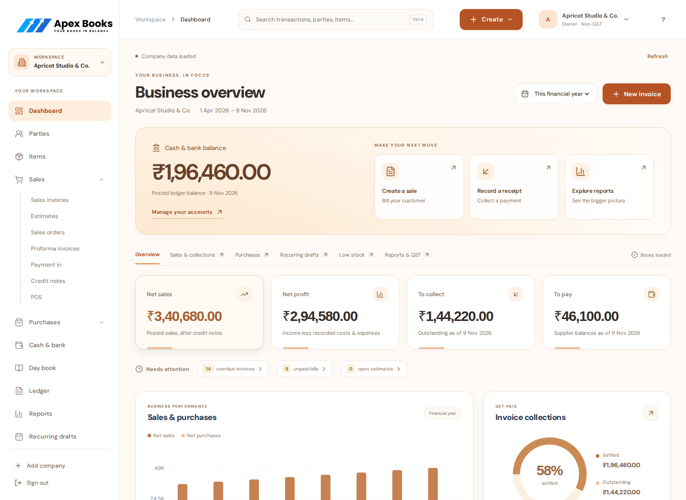
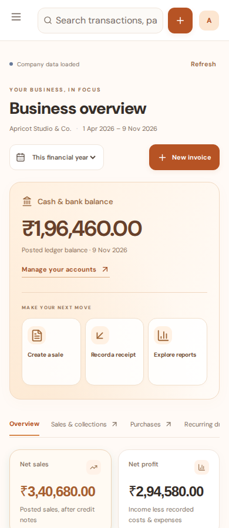
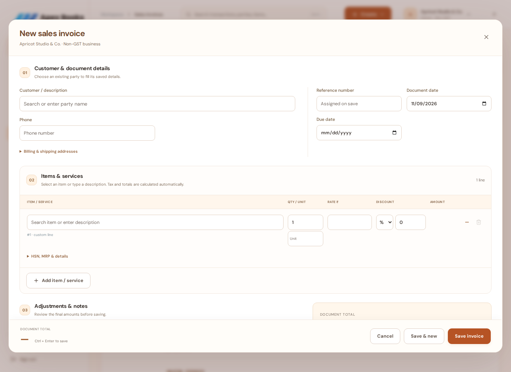

# Apex Apricot UI refresh — 9 November 2026

The requested light orange and white direction replaces the compact navy workspace. The implementation covers the React web application, Jetpack Compose Android application and WinUI Windows application. Each keeps its native navigation and controls.

## Screens

These captures use an isolated local database and deliberately synthetic business records. The displayed balances are calculated by the API from those records.

| Phone overview | Invoice workbench |
|---|---|
|  |  |

The native [Android dashboard capture](images/apricot/android-dashboard.png) comes from the passing emulator run.

## Changes

- White navigation and cards, a warm off-white canvas, peach highlights and burnt-orange actions. Dark text keeps financial figures readable.
- Bundled DM Sans on the web as well as both native clients. The web no longer requests its UI font from Google Fonts; the font license ships with the asset.
- A leading cash and bank balance panel with direct billing and account actions. Web also provides collection and report actions in this panel. Named bank ledger accounts are included, using the existing financial report.
- Larger financial cards, more space between sections, rounded surfaces, warm charts and clearer register, report and settings layouts.
- A compact setup prompt that expands when needed, leaving the main financial overview visible first.
- A warmer sign-in experience and a paper-like web invoice workbench with numbered sections and a persistent total/action footer.
- Phone layouts retain the navigation drawer, readable entry controls and existing financial safeguards. Android's dashboard uses its visible billing actions without a floating Create button obscuring a metric.

The source of the palette is `native/shared/design-tokens.json`, mirrored in the web CSS, Android `UiKit.kt` and Windows resources/helpers. Historical `navy-*` token identifiers remain for compatibility; their values now hold the Apricot palette. No accounting calculations, API contracts, database migrations or dependency versions changed in this refresh.

## Validation

All writes use disposable local accounts and databases. Production books and hosted APIs were not used.

| Check | Result |
|---|---|
| Web unit tests, ESLint and production build | 125 tests passed; lint and build passed. Vite retains its existing large-chunk advisory. |
| Chromium and HTTP accounting journeys | Passed: invoice entry, partial collection, exact-document search, dirty drafts, exports, recurring drafts, cancellation locks, mobile filters, unknown-response recovery and complete-backup round trip. |
| Responsive browser checks | Passed at 320, 390, 768 and 1024 px. The setup test expands the checklist and verifies all five steps before measuring geometry. Desktop and phone screens were also visually reviewed with populated synthetic records. |
| Android debug build, unit tests and lint | Build passed; 52 unit tests passed, one optional HTTP test skipped; lint has 20 warnings and no errors. |
| Android emulator journeys | All four instrumentation tests passed on Android 10 / API 29: sign-in, company switching, billing/collection, drafts, reorder review, native receipt picker and encrypted backup/restore, plus HTTP/PDF/image checks. |
| Windows C# syntax | All 44 application source files parsed successfully. |
| Windows WinUI build and UI smoke | Checked by the existing Windows GitHub Actions jobs after push; Linux syntax checks do not establish Windows runtime acceptance. |
| Source hygiene | `git diff --check` passed. |

The Windows UI harness now closes the automatic post-save detail before opening the invoice from its register. This avoids invoking a background register button while the foreground detail is still open and retains the original partial-payment and canonical-balance assertions.

Physical Android devices, hardware printing, Windows installer/update acceptance and signed production packaging remain separate release checks. This source refresh does not deploy the VPS or publish a signed installer/APK. Use [the build and rollout guide](DEPLOY_AND_BUILD.md) for those steps.
