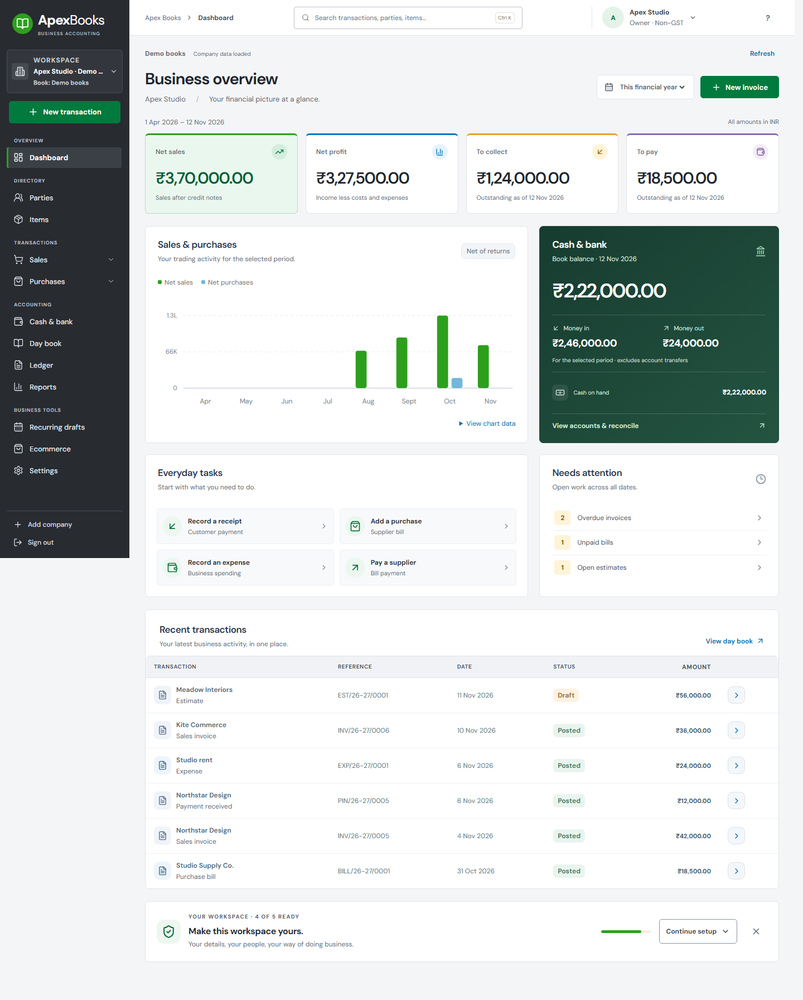

# ApexBooks workspace revamp — 12 November 2026

Follow-up: [web performance, accessibility and PostgreSQL release review](WEB_RELEASE_REVIEW.md) closes the initial bundle-size and local concurrency/assistive-technology verification gaps recorded below.

This revision follows the requested QuickBooks-inspired direction across the web, Windows and Android clients. It combines a substantial interface refresh with corrections to accounting and transaction workflows. All development and acceptance data are synthetic and local.

## Product research and design decisions

Official product documentation was reviewed before implementation:

- [QuickBooks navigation](https://quickbooks.intuit.com/learn-support/en-us/help-article/product-setup/navigate-quickbooks-online-menus-transactions-set/L5eM9dp7W_US_en_US): a central Create menu and task-oriented navigation informed the grouped transaction launcher and visible next actions.
- [QuickBooks navigation reference](https://quickbooks.intuit.com/content/dam/intuit/quickbooks/QBOL1-manual.pdf): the familiar dark navigation rail, green actions and restrained accounting tables informed the visual direction. QuickBooks has multiple interface versions; this implementation retains ApexBooks branding and its supported workflows.
- [Zoho Books home](https://www.zoho.com/us/books/help/home/): financial overview and setup guidance informed the resumable checklist and focused dashboard.
- [Xero homepage](https://central.xero.com/0/article/Your-Xero-dashboard): bank balances, invoices owed and bills due informed the separation of performance, cash and outstanding work.
- [FreshBooks dashboard](https://support.freshbooks.com/hc/en-us/articles/115015407988-How-do-I-use-my-dashboard): the relationship between financial summaries and creation shortcuts informed the everyday-task area.
- [myBillBook business reports](https://mybillbook.in/s/features/business-reports/): report discovery informed search, categories and business-question shortcuts.

Research used public documentation, not authenticated testing of competitors' products. Financial calculations remain ApexBooks' own tested implementation.

## Interface and flows

The desktop workspace has a dark navigation rail, green creation actions, blue links, compact financial cards and neutral document surfaces. The trading chart appears directly beneath the headline figures. A distinct cash panel shows book balances and money received/paid for the selected period. Phone layouts use compact metrics and readable transaction cards.

Navigation groups directory, transactions, accounting and business tools. Sales/purchase submenus expand when needed. The Create menu groups related documents, supports keyboard navigation and returns focus to its trigger. Recent transactions open their actual detail instead of leaving the user to search a register. Dashboard work queues reset unrelated date/party filters.

| Screen family | Review and changes | Verification scope |
| --- | --- | --- |
| Sign-in, company setup and navigation | Consistent theme, clear current company, compact sidebar, keyboard menu, contextual setup destinations | Web lifecycle and responsive/axe checks; Windows live sign-in/company switching |
| Dashboard | Four core totals, chart before secondary tasks, cash/movement panel, attention queues, correct cancellation handling and real creation-time ordering | Six viewport widths plus maximum supported financial amounts; source/unit regressions |
| Parties and items | Save lock, whitespace validation, dirty-edit protection, direct creation and editing | Component tests, browser screen checks, API master tests |
| Sales, purchases, estimates, orders, proformas, returns and expenses | Consistent details/items/review sections, clearer tax basis, added-line focus, discount limits and persistent save actions | All create forms on phone/desktop; real invoice/receipt and estimate/recurring journeys |
| Registers and document details | Clear cancellation/settlement states, unknown balances stay unknown, contextual next actions, safe browser Back during cancellation | Component regressions; browser lifecycle and Windows UI |
| Reports | Business-question shortcuts, searchable categories, corrected as-of balance wording | All 16 reports and GST working papers opened and audited |
| Settings | Company first; business/accounting/data/access/security separated; diagnostics in About | All seven categories opened and audited |
| Banking and statement import | Reviewed mappings frozen during import, exact retry after uncertain response, cancelled match candidates excluded | Component regressions and HTTP matching/reconciliation workflows |
| Advances and POS | Advance dates respect both source documents; cancelled targets excluded; POS clears prior customer identity after checkout and shows cash shortfall | Component/API tests; existing retained-request and navigation-lock coverage |
| Imports and backup/restore | CSV type/file fixed during operations, ambiguous headers rejected, validated restore payload retained across retries, single-flight complete backups | Import/backup regression tests, full HTTP round-trip and native encrypted backup/restore |
| Stock, cash transfers, recurring/reorder and ecommerce | Screen/source audit, common visual finish, existing explicit posting and retry controls retained | Existing unit/API suites; specialist end-to-end coverage varies |

## Accounting corrections

- Normal sales and purchases cannot opt out of required stock movement while still posting inventory/COGS.
- Cancelled credit/debit notes release their amount/tax capacity and stop blocking valid document corrections.
- Client-supplied metadata cannot forge cancellation, document versions, import lineage or store ownership.
- Cancellation reasons are trimmed before validation.
- Amount-only expense corrections change both the expense amount and its ledger entries.
- Cancelled/unposted documents are excluded from posted register totals and payment actions. Windows and Android collection figures exclude future invoices.
- Report-summary receivables/payables use the selected as-of date, including dated settlements rather than future activity.

No database schema migration is required. Existing production books were not rewritten; prevention tests do not establish whether historical data needs correction.

## Local review

Start the synthetic preview from the repository root after installing the documented dependencies:

```powershell
.venv/Scripts/python.exe scripts/preview_local.py
```

The preview binds to loopback at `http://127.0.0.1:5173`, with a separate SQLite database under ignored `tmp/revamp-preview`. Demo credentials are `demo@apexbooks.local` / `ApexDemo-2026!`. These credentials belong only to the synthetic local preview. The runner strips inherited database/integration secrets, builds the frontend, seeds a demo business and owns its child processes. Stop it with Ctrl+C or `python scripts/preview_local.py --stop`.

The locally published Windows Debug app can use the same demo business while that preview is running:

```powershell
./scripts/open_desktop_preview.ps1
```

This launcher scopes the loopback API address to the new app process. It opens the review build under `native/windows/artifacts/revamp-ui-app`; it does not install a release or alter the user's server settings. The preview runner's stop/start cycle was checked to release both owned server ports cleanly.



[Invoice screen](images/revamp/web-invoice.png) · [Report library](images/revamp/web-reports.png) · [Phone overview](images/revamp/web-mobile.png)

Native screenshots and the native verification details are in [the native review](../native/NATIVE_REVAMP_REVIEW.md).

## Validation record

Final results are recorded after the last visual and as-of-accounting changes. Earlier passing runs are not substituted for final evidence. Local logs and traces live under ignored `tmp` and native build-artifact directories.

- Backend discovery: all 252 tests pass, including nine new regression tests and the as-of-summary correction. Evidence: `tmp/backend-audit.log`.
- Frontend: all 140 tests pass; lint and production build pass. The final setup-wording change also passed its focused checklist test. Evidence: `tmp/frontend-final.log`.
- Browser: real accounting, keyboard, search, exports, dirty-draft, cancellation and interrupted-save journeys pass. All 122 accessibility/layout captures passed with zero axe violations, including financial-figure fit assertions, six dashboard widths, all 16 reports, all settings categories and phone/desktop entry screens. Evidence: `tmp/quickbooks-final-evidence`, `tmp/quickbooks-final.log`.
- Windows: Debug build/publish and portable client tests pass. The chart-first build, including chart legend colors and DPI-aware window sizing, passes all 35 live UI assertions: invoice typing, partial settlement, draft safeguards, native receipt picker/archive, encrypted Save/Open/restore, canonical report comparison and exact receipt bytes. Evidence: `native/review/windows-runtime-result.json`. A subsequent compact-menu spacing/contrast correction compiled and passed nine focused runtime assertions, including sign-in, company switching, non-overlap geometry and keyboard Open/Close. The final desktop demo launcher was started successfully against the separate preview API.
- Android: Debug app and instrumentation APK compile; 54 unit tests pass with zero skips. Real API 35 emulator acceptance passes: company switching, invoice/payment flows, receipt upload/archive, encrypted backup and restore with canonical report/receipt comparisons, and dashboard/entry at 150% text size. Thirteen screenshots were captured; selected normal and large-text evidence is in `native/review`.

Production PostgreSQL concurrency/load, real tax filing, hardware printing, signed release installation/update and all possible device configurations require separate acceptance. Existing Windows statement nullable warnings and the web bundle-size advisory are recorded rather than hidden. Automated accessibility scans complement visual/keyboard review; they do not prove all accessibility requirements.
