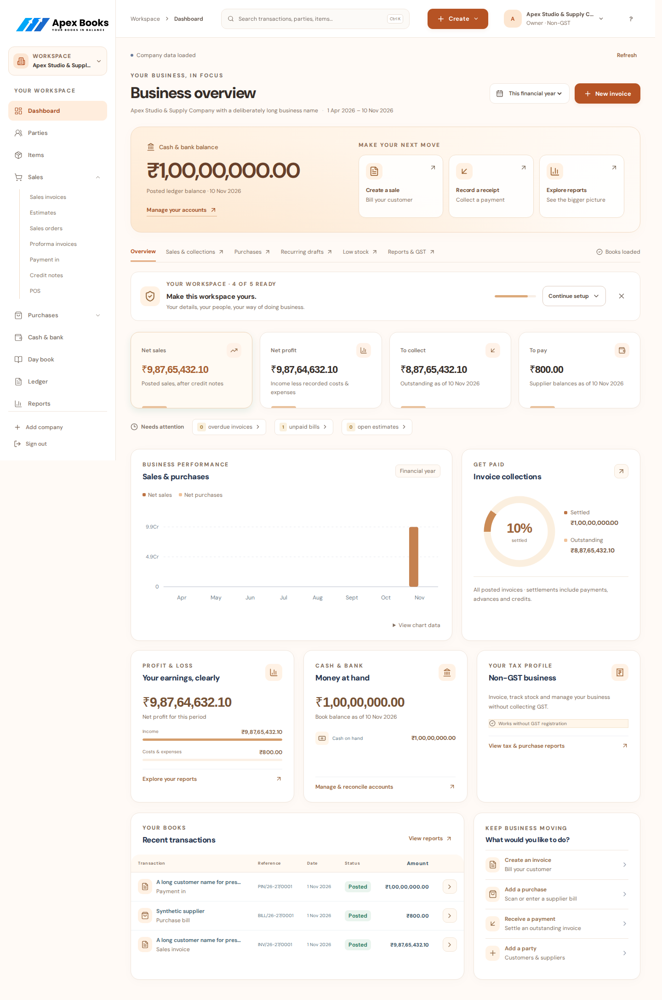
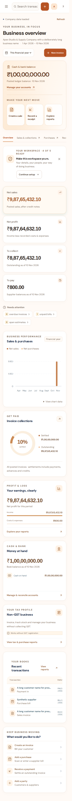
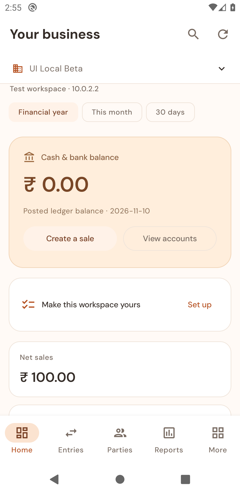
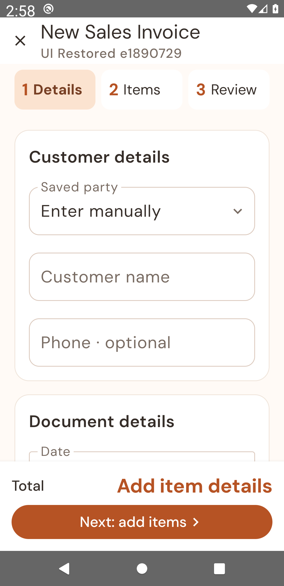
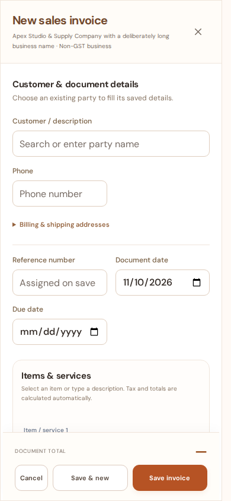

# Cross-platform UI release review — 10 November 2026

The Apricot design is retained across React, Jetpack Compose and WinUI. This revision improves readable supporting text, controls, keyboard access and layouts under narrow windows, long business names and large Indian-currency amounts. Test writes use disposable local books only.

## What changed

- Web supporting text has consistent contrast and readable sizing across dashboards, registers, reports and settings. Phone metrics use the available width so complete amounts remain on one line. Company headings truncate within their own bounds.
- The phone navigation drawer has a close action, focus containment, Escape dismissal, background isolation and focus return. A keyboard skip link reaches the workspace. Document dialogs lock background scrolling and preserve scroll position.
- Register overflow actions use the browser top layer, with arrow-key navigation and focus return. Menus stay visible beyond table boundaries. Scrollable tables accept keyboard focus.
- Invoice discounts have room for both their mode and numeric input. Phone adjustment labels wrap, footer actions respect safe areas, and input text remains at least 16 px on phones. Sign-in supports password visibility and credential autofill.
- Android metrics and action rows reflow for window width and system font scaling. The company switcher has its own 48 dp row, separated from the page title. Form headings ellipsize safely; notices are announced accessibly; dialog content respects system insets. Redundant blank space below the dashboard is removed.
- Windows navigation adapts to the window; form columns, financial metrics, header search and dialog footer actions reflow. Narrow registers use cards with readable names and amounts. Settings stays pinned in the navigation footer; four metrics keep balanced rows instead of leaving a single card below three others. Common buttons wrap their text and retain their accessible names during asynchronous operations. Password and date controls use consistent minimum heights. Dialog bounds follow window resizing.
- Shared design tokens now record supporting typography, spacing and platform target sizes. Primary-button progress indicators keep a contrasting foreground on both native platforms.

## Screens



| Web phone | Android phone | Android at 150% text |
| --- | --- | --- |
|  |  |  |



## Verification

| Gate | Current evidence |
| --- | --- |
| API/accounting regressions | 243 tests passed in the isolated release suite. |
| Web components/helpers | 125 tests passed. |
| Web ESLint and production build | Passed. The existing Vite large-chunk advisory is still present. |
| Local HTTP accounting and complete backup | All five accounting tests and the backup round trip passed. |
| Web accounting browser journeys | Passed: invoice save, partial receipt, exports, search, dirty drafts, cancellation locking and lost-response recovery. |
| Presentation and accessibility | Passed 88 axe scans, six dashboard widths (320–1920 px), all 13 entry forms at phone and desktop sizes, all 16 reports, registered-GST invoice layouts at five widths and three GST working papers, every settings category, keyboard drawer/menu operation and dialog scroll locking. |
| Android debug build, units and lint | Passed: 52 unit tests (one optional HTTP unit case skipped), debug and instrumentation builds, and lint. All four real Android 10 emulator journeys passed, including billing, collection, company switching, retained receipts and encrypted backup/restore. The genuine UI journey also passed again with a 150% system-text check. Bottom navigation uses an untruncated Entries label on phones and keeps the full Transactions accessibility name. |
| Windows portable client | Passed. |
| Windows source syntax, XAML XML and UI harness | All 44 application C# files parsed; XAML files are well formed; the UI automation harness compiles with no warnings. The harness now resizes the genuine app window and checks header controls. This does not establish WinUI application compilation or runtime behaviour. |
| Windows native build/UI and unsigned release | Both Android and Windows unsigned release builds passed in [CI](https://github.com/alpesh15gb/ApexBooks/actions/runs/42702080660). The current [PR checks](https://github.com/alpesh15gb/ApexBooks/pull/48/checks) track the final revision and genuine Windows UI gate. |

Reproduce:

```sh
npm ci --prefix frontend
PYTHON=/path/to/python bash scripts/check.sh
/path/to/python tests/e2e/run_local.py --browser --presentation --artifacts .native-build/ui-release
```

The browser CI now runs the presentation suite with the pinned `axe-core` development dependency. It retains screenshots, an accessibility JSON report and traces. A narrow-screen grid regression now also checks overflow inside the invoice form, where clipping can conceal an overflowing field without enlarging the page. The suite uses real local API data, including a long legal company name and an invoice worth ₹9,87,65,432.10. The release must also pass the existing native build and genuine-UI gates; syntax checks and browser emulation are insufficient substitutes.

## Release boundary

This is a source/UI readiness review. Production deployment, release signing and installer/update acceptance require their own successful gates. Physical-device printing, sharing and signed update behaviour are not established by emulator or unsigned-build checks. No production books or hosted APIs were used for synthetic writes.
